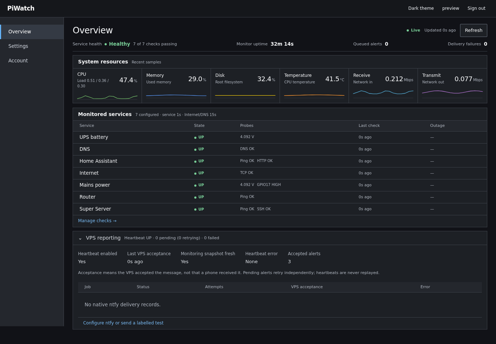

# PiWatch

PiWatch is a Raspberry Pi monitor for a home network. It checks services, Internet
access, DNS, and power, then sends outage and recovery alerts through Meshtastic,
Home Assistant, ntfy, or email. A local dashboard and OLED show what is happening on the
Pi itself.

With a battery supply and a Meshtastic radio, it can keep monitoring and send radio
alerts during an Internet or mains outage.



## What it does

- **Service checks.** Ping, TCP, and HTTP probes for routers, servers, Home
  Assistant, or other local services. Internet reachability and DNS are checked
  separately. Consecutive failures qualify an outage before an alert is sent.
- **Outage alerts.** LoRa and IP delivery run in the background. Queued alerts and
  delivery progress survive restarts; failed deliveries stay available for review.
  LoRa alerts wait for a destination acknowledgment and retry when needed.
- **Off-site dead man's switch.** PiWatch sends a heartbeat to private ntfy once
  per second, reporting whether its monitoring data is fresh. After the first
  healthy heartbeat, the VPS alerts on three consecutive missing or invalid
  samples and sends a recovery when a fresh heartbeat returns. The alert means
  the Pi or its reporting path is unavailable. Detailed incidents stay queued
  on the Pi during an internet outage and are retried when connectivity returns.
- **Local dashboard.** Service status, incident history, delivery queues, and live
  CPU, memory, disk, temperature, and network metrics. Targets and settings can be
  changed in the panel without restarting the monitor.
- **Power monitoring.** An INA219 measures battery voltage and a GPIO input tracks
  mains power. A Pico supervises the shutdown sequence when the battery stays low.
- **OLED display.** Rotating system, network, GPS/time, and watchdog pages, with
  mains-change overlays and a low-battery shutdown countdown.
- **Home Assistant metrics.** MQTT Discovery publishes system and power sensors,
  including an estimated battery percentage. Stale readings expire rather than
  continuing to look current.
- **Radio queries.** An authorized Meshtastic node can request `status`, `power`,
  `problems`, incident history, and other short reports by direct message.

The panel supports password login, authenticator-app or email two-factor
authentication, and recovery codes. Its frontend assets are served locally, so it
can still be used when the Internet connection is down.

## How it fits together

The watchdog writes a shared status snapshot. The web panel, OLED, and MQTT
publisher read that snapshot; a separate gateway owns the Meshtastic USB connection.
Each component runs as its own systemd service.

| Component | Source | Role |
| --- | --- | --- |
| Watchdog | `watchdog/` | Checks, incident state, power supervision, notification queue |
| Radio gateway | `lora/` | Meshtastic connection, delivery acknowledgments, radio queries |
| OLED | `oled/` | Display pages, GPS/time information, power overlays |
| Web panel | `web/` | Dashboard, settings, account management |
| VPS heartbeat | `watchdog/piwatch-heartbeat.py` | Independent freshness reporting to private ntfy |
| MQTT publisher | `watchdog/piwatch-ha-mqtt.py` | Home Assistant Discovery and sensor updates |

Settings and incident state are stored in SQLite. Notification stages are
checkpointed so a restart can resume unfinished work. Retries can still produce a
duplicate alert if delivery succeeds but confirmation is lost.

## Hardware

The current setup uses a Raspberry Pi running Linux and systemd, a USB Meshtastic
radio, a 128×64 SSD1306 OLED, an INA219 battery sensor, and a Pico UPS supervisor.
GPS and PPS feed gpsd and chrony for timekeeping.

The wiring is specific to this build: the OLED uses I²C bus 6 at `0x3C`, the INA219
uses bus 3, and GPIO17 is the mains input. The Pico command line on GPIO2 must only
be pulled LOW or released; GPIO3 is reserved for the Pico's wake signal. Check the
power-supervisor documentation before adapting the wiring.

## Setup and configuration

This repository contains the source and deployment procedures for a running
installation. The scripts assume existing hardware, service accounts, and runtime
environments; review their paths and prerequisites before using them on another Pi.

- [Installation and web panel setup](deployment/WEB_PANEL.md)
- [Notification delivery, UPS testing, and recovery](deployment/README.md)
- [ntfy integration, controlled cutover, and Mac verification](deployment/NTFY.md)
- [Private configuration and environment files](deployment/PRIVATE_CONFIGURATION.md)

Keep passwords, tokens, real network addresses, and device selections in the
installation's private environment files or settings database. Databases, session
keys, backups, and local environment files stay outside version control. A service
must explicitly load its environment file; saving one in the checkout does not
configure the service.

The web listener defaults to loopback. Use an SSH tunnel or configure HTTPS for
access from another machine.

## Development

There is no build step. Python dependencies are described in the deployment docs,
with separate requirements files for the web panel and MQTT publisher.

```bash
python3 -m compileall -q oled lora watchdog web tests
python3 -m unittest discover -s tests -v
```

See [tests/README.md](tests/README.md) for test dependencies and individual suites.
Tests use temporary state and mocks; they do not validate physical wiring or radio
delivery. Panel tests skip when their dependencies are missing.

## License

[MIT](LICENSE).
